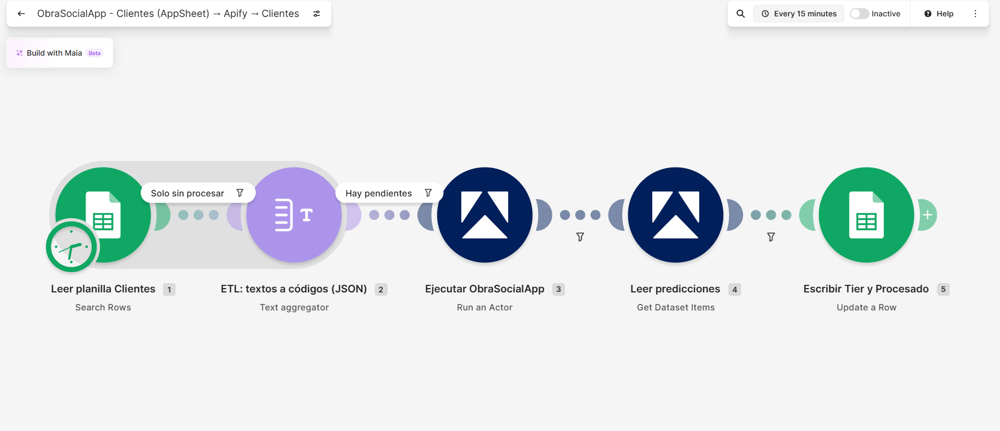

# ObraSocialApp: clase de ingreso a partir de un formulario

Actor de Apify que estima la **clase de ingreso** de una persona joven que trabaja (de **18 a 30 años**) a partir de las **10 respuestas de un formulario**. Usa un modelo de machine learning entrenado con la [Encuesta Permanente de Hogares (EPH) del INDEC](https://www.indec.gob.ar/indec/web/Institucional-Indec-BasesDeDatos). La app de AppSheet **VeritasSalud** usa esa clase como perfil de gasto del cliente, para mostrarle los planes de salud de su ciudad y de su rango de precios.

* **Actor:** [`tinchoars/obrasocialapp`](https://apify.com/tinchoars/obrasocialapp)
* **Repositorio:** [`TinchoARS/VeritasSalud`](https://github.com/TinchoARS/VeritasSalud)
* **Escenario de Make (público):** [ObraSocialApp - Clientes (AppSheet) → Apify → Clientes](https://us2.make.com/public/shared-scenario/2lFqxZH6DS4/obra-social-app-clientes-app-sheet-ap)

|Clase|Ingreso mensual de la ocupación principal|
|-|-|
|1|menos de $600.000|
|2|de $600.000 a $1.200.000|
|3|más de $1.200.000|

Para cada respuesta devuelve la clase con su tramo en pesos, la **ciudad** (aglomerado EPH) y la **región**. El Actor **no hace scraping ni descarga nada** y **no guarda las respuestas**: recibe el JSON desde Make, lo prepara y ejecuta el modelo.

---

## 1. Arquitectura y flujo

```text
App AppSheet ──▶ Google Sheets "Clientes" ──▶ Make (schedule cada 15 min + ETL: textos a códigos)
──▶ Apify ObraSocialApp (validación + preprocesamiento + inferencia) ──▶ Dataset de Apify
──▶ Make (escribe Tier y Procesado) ──▶ Google Sheets "Clientes" ──▶ App: planes según clase, región y edad
```



|Etapa|Dónde|Qué hace|
|-|-|-|
|Trigger|Make|Corre cada 15 minutos y lee la planilla `Clientes`. Se queda solo con las filas que no tienen `Procesado` = TRUE. Si no hay pendientes, termina sin llamar a Apify.|
|ETL|Make|Pasa las respuestas de la app al formato del Actor (por ejemplo Masculino → 1, Gran Rosario → 4, inquilino TRUE → 1). Junta todos los pendientes en un solo input y usa el número de fila como `id_respuesta`.|
|Preprocesamiento|Apify|Valida la forma del input, reconoce cada pregunta y convierte cada respuesta al código que vio el modelo. Junta todos los errores de cada formulario.|
|Inferencia|Apify|Ejecuta `modelos/modelo.pkl` solo con los formularios válidos. Un formulario inválido no frena al resto.|
|Destino|Make → Sheets|Escribe `Tier` = clase de ingreso (o `Revisar datos: <campos>` si fue inválido) y `Procesado` = TRUE en la fila de cada cliente.|

Se usa un **batch cada 15 minutos** y no un webhook por respuesta. El motivo es que procesar 1 o 1000 formularios en una ejecución cuesta casi lo mismo (ver [costo](#7-costo-computacional-de-una-corrida-de-inferencia)).

---

## 2. Estructura del repositorio

```text
VeritasSalud/
├── .actor/
│   ├── actor.json                   # configuración del Actor
│   ├── input_schema.json            # input: formularios
│   ├── dataset_schema.json          # campos de cada resultado
│   ├── output_schema.json           # links a resultados y resumen
│   └── key_value_store_schema.json  # registro RESUMEN
├── my_actor/
│   ├── main.py              # ciclo de vida del Actor (único módulo que usa el SDK de Apify)
│   ├── procesamiento.py     # orquesta entrada → preprocesamiento → modelo → salida
│   ├── entrada.py           # valida la forma del input
│   ├── esquema.py           # las 10 preguntas, opciones aceptadas, ciudades y constantes
│   ├── normalizacion.py     # conversores de texto, números y opciones
│   ├── preprocesamiento.py  # respuestas → valores validados → fila de features
│   ├── modelo.py            # carga segura del pickle y predicción
│   ├── salidas.py           # arma cada resultado y el resumen, sin datos personales
│   └── errores.py           # excepciones propias
├── modelos/
│   └── modelo.pkl           # modelo entrenado (el Actor solo hace inferencia)
├── tests/                   # 156 tests con pytest (incluye el modelo real)
├── docs/
│   └── make-workflow.png    # captura del escenario de Make
├── Dockerfile               # imagen apify/actor-python:3.12
├── requirements.txt         # mismas versiones que el entrenamiento
└── README.md
```

---

## 3. Actor de Apify

* **Código:** `my_actor/main.py` (se ejecuta con `python -m my_actor`)
* **Input:** `.actor/input_schema.json`: un campo, `formularios`, con hasta 1000 respuestas
* **Output:** `.actor/output_schema.json`, que apunta a:
  * el dataset (`.actor/dataset_schema.json`): un ítem por formulario;
  * el registro `RESUMEN` del key-value store (`.actor/key_value_store_schema.json`).
* **Cómo correrlo:**

```bash
# Local: lee storage/key_value_stores/default/INPUT.json y escribe en storage/datasets/default/
python -m my_actor

# En la plataforma de Apify
apify call tinchoars/obrasocialapp --input-file=storage/key_value_stores/default/INPUT.json --output-dataset
```

### Desde Make

1. Agregá el módulo **Apify → Run an Actor**, elegí `tinchoars/obrasocialapp` y activá la ejecución sincrónica.
2. En el input mandá `formularios`: una lista con un elemento por respuesta, cada uno con `id_respuesta` y `respuestas`.
3. Leé los resultados con **Apify → Get Dataset Items**, usando el `defaultDatasetId` de la ejecución.
4. Separá por `estado`: con `ok` usá `clase_ingreso` y el tramo; con `invalido` mirá `errores`.

### Desde la consola o por API

En la pestaña **Input** de la consola de Apify ya hay un formulario de ejemplo cargado: tocá **Start** y mirá el resultado en **Output**.

Por API, el endpoint sincrónico ejecuta el Actor y devuelve directamente los resultados. Reemplazá `$APIFY_TOKEN` por tu token (pestaña **API** de la consola):

```bash
curl -X POST "https://api.apify.com/v2/acts/tinchoars~obrasocialapp/run-sync-get-dataset-items" \
  -H "Authorization: Bearer $APIFY_TOKEN" \
  -H "Content-Type: application/json" \
  -d '{"formularios": [{"id_respuesta": "fila-2", "respuestas": {"cobertura_salud": "Obra social", "edad": 27, "nivel_educativo": "Universitario completo", "formalidad_empleo": "Sí", "sexo": "Mujer", "tamano_establecimiento": "De 6 a 40", "horas_trabajo": 40, "calificacion_ocupacion": "Técnica", "aglomerado": "Gran Rosario", "inquilino": "Sí"}}]}'
```

---

## 4. Funciones de ETL, preprocesamiento y modelo

|Función|Input|Output|Descripción|
|:---|:---|:---|:---|
|Make: módulo *ETL: textos a códigos*|Filas pendientes de la planilla `Clientes`|`{"formularios": [...]}`|Traduce las opciones de la app a los códigos del Actor y arma un solo input con todos los pendientes|
|`entrada.leer_formularios()`|Input JSON del Actor|Lista de `Formulario(id_respuesta, respuestas)`|Valida la forma del input: de 1 a 1000 formularios, cada uno con `id_respuesta` y `respuestas` (también como texto JSON). Si no la cumple, la ejecución falla con un mensaje claro|
|`preprocesamiento.unificar_claves()`|Respuestas con el texto de cada pregunta|Respuestas con la clave interna|Reconoce cada pregunta sin importar mayúsculas, acentos ni signos. Ignora las columnas que no son del modelo (mail, nombre, fecha)|
|`preprocesamiento.preprocesar_respuestas()`|Respuestas de un formulario|`RespuestaProcesada` (valores + errores)|Convierte cada respuesta según su tipo (número, entero, código EPH o categoría), valida obligatorios y rangos, y junta todos los errores del formulario|
|`normalizacion.convertir_numero()`, `convertir_codigo()`, `convertir_categoria()`|Texto o número|Número, código EPH o categoría|Conversores puros: números en formato argentino (`$ 1.234,56`), etiquetas → código EPH, opciones → el texto que vio el modelo|
|`preprocesamiento.a_features()`|Valores validados|Fila con las 10 features en el orden del modelo|Arma la fila que espera el pipeline|
|`modelo.cargar_modelo()`|`modelos/modelo.pkl`|`ModeloCargado` (pipeline, cortes, features, versión)|Lee el pickle con un `Unpickler` restringido (solo clases de scikit-learn, numpy y scipy). Valida que tenga `predict()`, que los cortes sean crecientes y que las features coincidan con el formulario|
|`modelo.predecir()`|Filas de features|Clases 1, 2 o 3|Predice el ingreso (en escala logarítmica) y lo convierte en clase con los cortes: `np.digitize(prediccion, cortes) + 1`|
|`salidas.armar_resultado()`, `armar_rechazo()`|Clase o errores, y ciudad|Ítem del dataset|Agrega el tramo en pesos, la ciudad y la región. No copia ninguna respuesta de la persona|
|`salidas.resumir()`|Resultados de la ejecución|`{total, validos, invalidos, version_modelo}`|Resumen que se guarda en `RESUMEN`|
|`procesamiento.procesar()`|Input + modelo|Lista de resultados|Orquesta todo lo anterior, en el mismo orden del input|

Dentro del pickle, el pipeline de scikit-learn completa el preprocesamiento antes del modelo:

* `OrdinalEncoder` sobre la cobertura de salud (sin cobertura < obra social < prepaga);
* `TargetEncoder(smooth=20)` sobre la ciudad (aglomerado);
* el resto de las features pasa sin cambios.

### 💡 Modelo seleccionado

* **Modelo:** `GradientBoostingRegressor` de scikit-learn 1.6.1 (`learning_rate=0.05`, `max_depth=2`, `n_estimators=200`).
  * Predice log(1 + ingreso de la ocupación principal) y la clase sale de comparar esa predicción con dos cortes: **$582.267** y **$1.200.000**.
  * El primer corte está un poco por debajo de $600.000 porque así el modelo distingue mejor la clase 2. El resultado informa igual los tramos nominales de la tabla de arriba.
* **¿Por qué?:**
  * Se compararon 5 modelos con la misma partición. La búsqueda de hiperparámetros se hizo con validación cruzada de 5 grupos por hogar, optimizando mitad F1 macro y mitad F1 de la clase 3.
  * La clase 3 tiene pocos casos (12 %), por eso se sobremuestreó ×3 en el entrenamiento.
  * Se eligió el de **mayor accuracy en test**, que además tuvo el mayor F1 macro.

|Modelo|Score CV|Accuracy test|F1 macro test|Recall clase 3 test|
|-|-|-|-|-|
|**Gradient Boosting (ensamble)**|0,575|**0,689**|**0,669**|0,651|
|Ridge (clásico)|0,577|0,674|0,652|0,602|
|Random Forest (ensamble)|0,555|0,672|0,654|0,675|
|KNN (clásico)|0,556|0,669|0,646|0,663|
|MLP (red neuronal)|0,540|0,667|0,633|0,518|

* **Alternativas descartadas:**
  * Ridge, porque en validación cruzada quedó apenas arriba (0,577 contra 0,575), pero en test rindió menos.
  * Random Forest y KNN, que detectan algo mejor la clase 3 pero con menor accuracy y F1 macro.
  * La red neuronal, por el F1 macro y el recall de la clase 3 más bajos.
* **Qué pesa más en la predicción:** las horas trabajadas (0,34), si el empleo está registrado (0,30), la cobertura de salud (0,14) y la ciudad (0,09).

---

## 5. Contrato del actor de inferencia

|Campo|Dirección|Tipo de dato|Descripción|
|:---|:---|:---|:---|
|`formularios`|`input`|`array` (1 a 1000)|Una entrada por respuesta del formulario|
|`formularios[].id_respuesta`|`input`|`string` o `integer`|Identifica la respuesta (por ejemplo, el número de fila). No uses datos personales|
|`formularios[].respuestas`|`input`|`object` o `string` JSON|Pregunta → respuesta, con las [10 preguntas del formulario](#las-10-preguntas-del-formulario)|
|`id_respuesta`|`output`|`string`|El mismo identificador del input|
|`estado`|`output`|`string`|`ok` si se pudo predecir, `invalido` si alguna respuesta no sirve|
|`clase_ingreso`|`output`|`integer` o `null`|1, 2 o 3 (`null` si es inválido)|
|`ingreso_desde`|`output`|`integer` o `null`|Piso del tramo en pesos: 0, 600.000 o 1.200.000|
|`ingreso_hasta`|`output`|`integer` o `null`|Techo del tramo en pesos (`null` en la clase 3, que no tiene techo)|
|`aglomerado`|`output`|`integer` o `null`|Código EPH de la ciudad|
|`aglomerado_nombre`|`output`|`string` o `null`|Nombre de la ciudad|
|`region`|`output`|`string` o `null`|Región EPH: GBA, Pampeana, NOA, NEA, Cuyo o Patagonia|
|`errores`|`output`|`array` de `{campo, motivo}`|Campos con problemas y el motivo, sin repetir lo que respondió la persona. Vacío si es `ok`|
|`version_modelo`|`output`|`string`|Hash del pickle que hizo la predicción|
|`RESUMEN` (key-value store)|`output`|`object`|`total`, `validos`, `invalidos` y `version_modelo` de la ejecución|

Hay [ejemplos completos de input y output](#ejemplos-de-input-y-output) en los anexos.

---

## 6. Métricas

* **Métrica de negocio:** *pendiente de completar.*
* **Métrica de modelo:**
  * Accuracy **0,689** y F1 macro **0,669**.
  * Conjunto de evaluación: 607 personas ocupadas de 18 a 30 años de la EPH. Es el 20 % del total, separado por hogar y estratificado por clase, y no se usó para entrenar.

|Clase|Precisión|Recall|F1|Casos en test|
|-|-|-|-|-|
|1 (menos de $600.000)|0,75|0,78|0,76|246|
|2 ($600.000 a $1.200.000)|0,68|0,62|0,65|278|
|3 (más de $1.200.000)|0,55|0,65|0,59|83|

* **Consistencia con el entrenamiento:** se tomaron 1146 filas limpias de la EPH y se cargaron como formularios. El Actor dio la misma clase que el pickle aplicado directamente sobre esas filas en el 100 % de los casos. `tests/test_modelo_real.py` lo verifica con una muestra de 18 filas.

---

## 7. Costo computacional de una corrida de inferencia

Medido en ejecuciones reales en Apify (build 0.1.9, 1 GB de memoria):

||4 formularios|1000 formularios|
|-|-|-|
|Tiempo por corrida|7,1 s|7,8 s|
|Memoria máxima usada|129 MB|132 MB|
|CPU|1/4 de vCPU (Apify asigna 1 vCPU cada 4 GB de memoria); sin GPU|1/4 de vCPU; sin GPU|
|Unidades de cómputo|0,0020 CU|0,0022 CU|
|Costo total en Apify|~0,0005 USD|~0,0056 USD|

* **Costo estimado por 1.000 registros:** ~0,006 USD si van en una sola ejecución. Casi todo es la escritura de los 1000 ítems en el dataset (0,005 USD). El cómputo es menos de 0,0005 USD.
* Casi todo el tiempo de una corrida es el arranque y la carga del modelo. Por eso conviene el batch: 1000 respuestas en ejecuciones separadas costarían unos 0,50 USD, unas 90 veces más.
* **Peor caso con Make cada 15 minutos** y clientes nuevos en todas las pasadas: 2.880 ejecuciones al mes, alrededor de 1,50 USD. Make no llama a Apify cuando no hay pendientes.
* El Actor usa unos 130 MB: se puede bajar la memoria a 512 MB en las opciones de ejecución.

---

## 8. Cómo correr el proyecto

1. **Entorno:** Python 3.12 con las versiones de `requirements.txt`, que son las del entrenamiento (scikit-learn 1.6.1, numpy 2.0.2, pandas 2.2.2). Con otra versión de scikit-learn el pickle puede no cargar.

   ```bash
   python -m venv .venv
   source .venv/bin/activate        # en Windows: .venv\Scripts\activate
   pip install -r requirements.txt pytest
   ```

2. **Tests:** `python -m pytest -q`. `tests/test_modelo_real.py` compara la salida del Actor contra el modelo real.
3. **Actor local:** poné un input en `storage/key_value_stores/default/INPUT.json` y corré `python -m my_actor`. Los resultados quedan en `storage/datasets/default/`.
4. **Deploy:** `apify login` y después `apify push`.
5. **Make:** el [escenario es público](https://us2.make.com/public/shared-scenario/2lFqxZH6DS4/obra-social-app-clientes-app-sheet-ap). Necesita conexiones a Google Sheets y a Apify.
6. **Notebook y datos:** el entrenamiento (notebook de Google Colab) y los datos de la EPH no están en este repositorio, porque el Actor es solo inferencia. Para cambiar el modelo:
   1. reemplazá `modelos/modelo.pkl`;
   2. ajustá `my_actor/esquema.py` hasta que `cargar_modelo()` no informe features faltantes o sobrantes;
   3. actualizá `tests/test_modelo_real.py`.

---

## Anexos

### Las 10 preguntas del formulario

Todas son **obligatorias**. Las preguntas se reconocen por su texto o por la clave interna, sin importar mayúsculas, acentos ni signos. Las columnas que no son de estas 10 preguntas (marca temporal, nombre, mail) se ignoran y no se guardan.

|#|Pregunta (o clave interna)|Respuestas aceptadas|
|-|-|-|
|1|Cobertura de salud (`cobertura_salud`)|Obra social (o PAMI), Prepaga (o Mutual), Sin cobertura (o Ninguna, No tengo)|
|2|Edad (`edad`)|Número entero de 18 a 30|
|3|Nivel educativo (`nivel_educativo`)|Sin instrucción, Primario incompleto, Primario completo, Secundario incompleto, Secundario completo, Universitario incompleto, Universitario completo (terciario también vale), o el código EPH 1–7|
|4|¿Tu empleo está registrado? (`formalidad_empleo`)|Sí / No (también Registrado / No registrado, En blanco / En negro, Formal / Informal)|
|5|Sexo (`sexo`)|Varón / Mujer|
|6|¿Cuántas personas trabajan junto a usted en su ocupación principal? (`tamano_establecimiento`)|Hasta 5, De 6 a 40, Más de 40|
|7|¿Cuántas horas trabajaste la semana pasada en tu ocupación principal? (`horas_trabajo`)|Número de 1 a 168 (se aceptan decimales con coma o punto)|
|8|¿Qué calificación tiene tu ocupación? (`calificacion_ocupacion`)|Profesional, Técnica, Operativa, No calificada|
|9|Ciudad (`aglomerado`)|Una de las [32 ciudades de la EPH](#ciudades-aceptadas), por nombre o código|
|10|¿Alquilás la vivienda donde vivís? (`inquilino`)|Sí / No|

### Ejemplos de input y output

Input:

```json
{
  "formularios": [
    {
      "id_respuesta": "fila-2",
      "respuestas": {
        "Cobertura de salud": "Obra social",
        "Edad": "27",
        "Nivel educativo": "Universitario completo",
        "¿Tu empleo está registrado?": "Sí",
        "Sexo": "Mujer",
        "¿Cuántas personas trabajan junto a usted en su ocupación principal?": "De 6 a 40",
        "¿Cuántas horas trabajaste la semana pasada en tu ocupación principal?": "40",
        "¿Qué calificación tiene tu ocupación?": "Técnica",
        "Ciudad": "Gran Rosario",
        "¿Alquilás la vivienda donde vivís?": "Sí"
      }
    }
  ]
}
```

Output: cada formulario genera un ítem en el dataset, en el mismo orden en que llegó. El dataset se descarga en **JSON, CSV, Excel o HTML** desde la pestaña **Output** o por API.

```json
[
  {
    "id_respuesta": "fila-2",
    "estado": "ok",
    "clase_ingreso": 3,
    "ingreso_desde": 1200000,
    "ingreso_hasta": null,
    "aglomerado": 4,
    "aglomerado_nombre": "Gran Rosario",
    "region": "Pampeana",
    "errores": [],
    "version_modelo": "db5a69e676b8"
  },
  {
    "id_respuesta": "fila-5",
    "estado": "invalido",
    "clase_ingreso": null,
    "ingreso_desde": null,
    "ingreso_hasta": null,
    "aglomerado": 4,
    "aglomerado_nombre": "Gran Rosario",
    "region": "Pampeana",
    "errores": [
      { "campo": "cobertura_salud", "motivo": "opción no reconocida" },
      { "campo": "edad", "motivo": "mayor que el máximo permitido (30)" },
      { "campo": "sexo", "motivo": "obligatorio sin respuesta" }
    ],
    "version_modelo": "db5a69e676b8"
  }
]
```

Los motivos de error posibles son estos:

* `obligatorio sin respuesta`
* `opción no reconocida`
* `no es un número`
* `no es un número entero`
* `menor que el mínimo permitido (…)`
* `mayor que el máximo permitido (…)`

### Limitaciones

* Sirve solo para **personas de 18 a 30 años que trabajan**. Otras edades se rechazan como inválidas.
* Estima el ingreso de la **ocupación principal** de la persona, no el del hogar.
* Los montos en pesos corresponden al **período de la encuesta** y no se ajustan por inflación.
* La pregunta de **cuántas personas trabajan junto a usted** no cambia el resultado: el modelo la requiere, pero no le da peso.
* Es una estimación estadística: en aproximadamente 3 de cada 10 casos la clase no coincide con la real.

### Privacidad y datos personales

* El Actor **no guarda las respuestas** del formulario. El dataset lleva solo el identificador, la clase, el tramo, la ciudad y la región.
* Los errores informan el **nombre del campo** y el motivo, nunca el valor que cargó la persona.
* Los logs no muestran respuestas.
* No uses como `id_respuesta` datos que identifiquen a la persona (mail, DNI, nombre).

### Operación de la app de AppSheet

La app (celular y web) reduce la fricción para que el cliente sea procesado. Guarda los datos en una planilla de Google Sheets, con una fila por usuario: su ID, sus respuestas al cuestionario y las columnas que calcula o edita el escenario de Make.

* Cada usuario empieza completando el formulario de la pestaña **Mis Datos**, que lo carga en la base.
* Cada usuario solo puede ver y editar su propia fila. La app solo envía y recibe los datos de esa fila. Como segunda medida de seguridad, enmascara cualquier otra fila que pudiera mostrarse.
* Una vez procesado por el modelo, el cliente ve los planes que coinciden con su región, su edad y el rango de precios que le corresponde según su clase (`Tier`).
* Si el cliente modifica o actualiza sus datos, un bot lo vuelve a marcar como no procesado (`Procesado` = FALSE). Así el próximo batch de Make lo recalcula.

### Preguntas frecuentes

**¿Por qué un formulario salió `invalido`?**
Mirá `errores`: dice qué pregunta falta o qué respuesta no se reconoce. Los casos más comunes son:

* edad fuera de 18–30;
* una opción escrita distinto (por ejemplo «Seguro privado» en cobertura);
* una ciudad que no está en la EPH.

Un formulario inválido no frena a los demás.

**¿Por qué falló la ejecución entera?**
Solo falla si el input no tiene la forma esperada:

* falta `formularios`;
* viene vacío;
* tiene más de 1000 elementos;
* algún elemento no trae `id_respuesta` o `respuestas`.

El mensaje de estado de la ejecución dice cuál es el problema.

**¿Puedo usarlo para personas mayores de 30 o que no trabajan?**
No. El modelo se entrenó solo con jóvenes de 18 a 30 años con empleo; para otras personas la estimación no sería confiable.

**¿Dónde reporto un problema?**
En la pestaña **Issues** de este Actor en Apify o en los issues del repositorio de GitHub.

### Ciudades aceptadas

Se acepta el nombre, cualquiera de los otros nombres de la tabla, el código EPH o la columna del catálogo de planes (por ejemplo `agl_04_gran_rosario`).

|Código|Ciudad|Región|También se acepta|
|-|-|-|-|
|2|Gran La Plata|Pampeana|La Plata|
|3|Bahía Blanca - Cerri|Pampeana|Bahía Blanca, Cerri|
|4|Gran Rosario|Pampeana|Rosario|
|5|Gran Santa Fe|Pampeana|Santa Fe, Ciudad de Santa Fe|
|6|Gran Paraná|Pampeana|Paraná|
|7|Posadas|NEA||
|8|Gran Resistencia|NEA|Resistencia|
|9|Comodoro Rivadavia - Rada Tilly|Patagonia|Comodoro Rivadavia, Comodoro, Rada Tilly|
|10|Gran Mendoza|Cuyo|Mendoza|
|12|Corrientes|NEA||
|13|Gran Córdoba|Pampeana|Córdoba, Ciudad de Córdoba|
|14|Concordia|Pampeana||
|15|Formosa|NEA||
|17|Neuquén - Plottier|Patagonia|Neuquén, Plottier|
|18|Santiago del Estero - La Banda|NOA|Santiago del Estero, La Banda|
|19|Jujuy - Palpalá|NOA|Jujuy, San Salvador de Jujuy, Palpalá|
|20|Río Gallegos|Patagonia||
|22|Gran Catamarca|NOA|Catamarca, San Fernando del Valle de Catamarca|
|23|Gran Salta|NOA|Salta|
|25|La Rioja|NOA||
|26|Gran San Luis|Cuyo|San Luis|
|27|Gran San Juan|Cuyo|San Juan|
|29|Gran Tucumán - Tafí Viejo|NOA|Tucumán, San Miguel de Tucumán, Tafí Viejo|
|30|Santa Rosa - Toay|Pampeana|Santa Rosa, Toay|
|31|Ushuaia - Río Grande|Patagonia|Ushuaia, Río Grande|
|32|Ciudad Autónoma de Buenos Aires|GBA|CABA, Capital Federal, Ciudad de Buenos Aires|
|33|Partidos del GBA|GBA|GBA, Gran Buenos Aires, Conurbano, Conurbano bonaerense|
|34|Mar del Plata|Pampeana|Mar del Plata - Batán|
|36|Río Cuarto|Pampeana||
|38|San Nicolás - Villa Constitución|Pampeana|San Nicolás, Villa Constitución|
|91|Rawson - Trelew|Patagonia|Rawson, Trelew|
|93|Viedma - Carmen de Patagones|Patagonia|Viedma, Carmen de Patagones|
